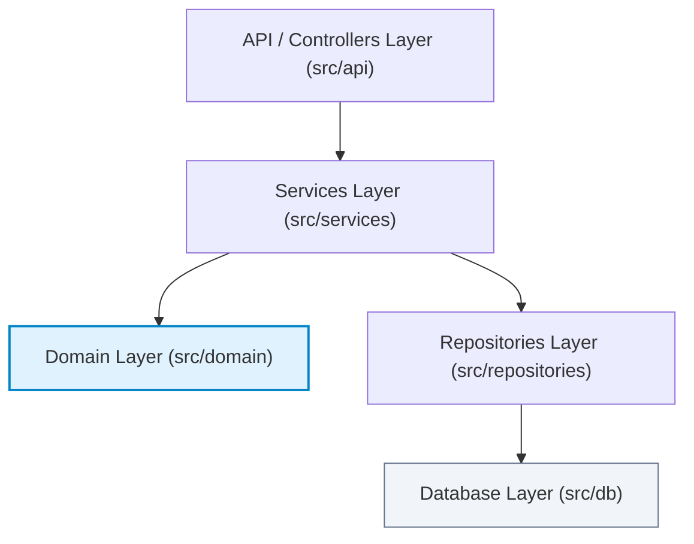

# MarketScope — Architecture Rules & Layering Contracts

**Business Case ID:** BC-AINE-006  
**System Architecture:** Strictly Layered Domain-Driven System  
**Linter Tooling:** `import-linter` & AST Structural Architecture Tests  

---

## 1. Layer Hierarchy & Control Flow



---

## 2. Core Architecture Rules

### Rule 1: Controllers Cannot Directly Access Database Implementations
- **Requirement:** API router functions MUST delegate business logic and persistence calls through `Service` classes. Routers MUST NOT import or instantiate repository classes directly.
- **Enforcement:** `import-linter` Layered Architecture Contract & `test_controllers_do_not_import_repositories_directly`.

### Rule 2: Domain Layer Cannot Depend on External Layers
- **Requirement:** `src/domain` MUST remain a pure python core with ZERO dependencies on `src/api`, `src/services`, `src/repositories`, or `src/db`.
- **Enforcement:** `import-linter` Domain Isolation Contract & `test_domain_has_zero_external_layer_imports`.

### Rule 3: Repositories Cannot Depend on Controllers
- **Requirement:** Repository classes MUST manage SQL persistence operations without referencing API schemas, request objects, or HTTP router modules.
- **Enforcement:** `test_repositories_do_not_import_controllers`.

### Rule 4: Executed Orders Cannot Be Mutated (NFR-02)
- **Requirement:** Trade orders in `EXECUTED` status ARE IMMUTABLE and append-only. Transitions back to `PENDING` or `CANCELLED` are illegal and raise `InvalidOrderStateException`.
- **Enforcement:** `src/domain/order_policy.py`, `src/domain/order_rules.py` & `test_executed_orders_cannot_be_mutated`.

### Rule 5: ADMIN Endpoints Require ADMIN Authorization (NFR-04)
- **Requirement:** All administrative API endpoints under `/api/v1/admin/*` MUST include the `require_admin` FastAPI security dependency.
- **Enforcement:** `src/api/dependencies.py` & `test_admin_endpoints_require_admin_authorization`.

### Rule 6: Financial Calculations Must Use Decimal (NFR-01)
- **Requirement:** All prices, quantities, cash, and P&L metrics MUST use Python `Decimal` exclusively. Floating-point arithmetic (`float`) is strictly prohibited.
- **Enforcement:** AST AST scanner `test_financial_calculations_never_use_float_ast` & `test_financial_models_use_decimal_types`.

---

## 3. Import Linter Verification Results

```ini
[importlinter]
root_package = src

[importlinter:contract:1]
name = Layered Architecture Contract
type = layers
layers =
    src.api
    src.services
    src.repositories
    src.domain

[importlinter:contract:2]
name = Domain Isolation Contract
type = forbidden
source_modules =
    src.domain
forbidden_modules =
    src.api
    src.services
    src.repositories
    src.db
```

### Linter Execution Output
```bash
=============
Import Linter
=============

---------
Contracts
---------

Analyzed 49 files, 117 dependencies.
------------------------------------

Layered Architecture Contract KEPT
Domain Isolation Contract KEPT

Contracts: 2 kept, 0 broken.
```
