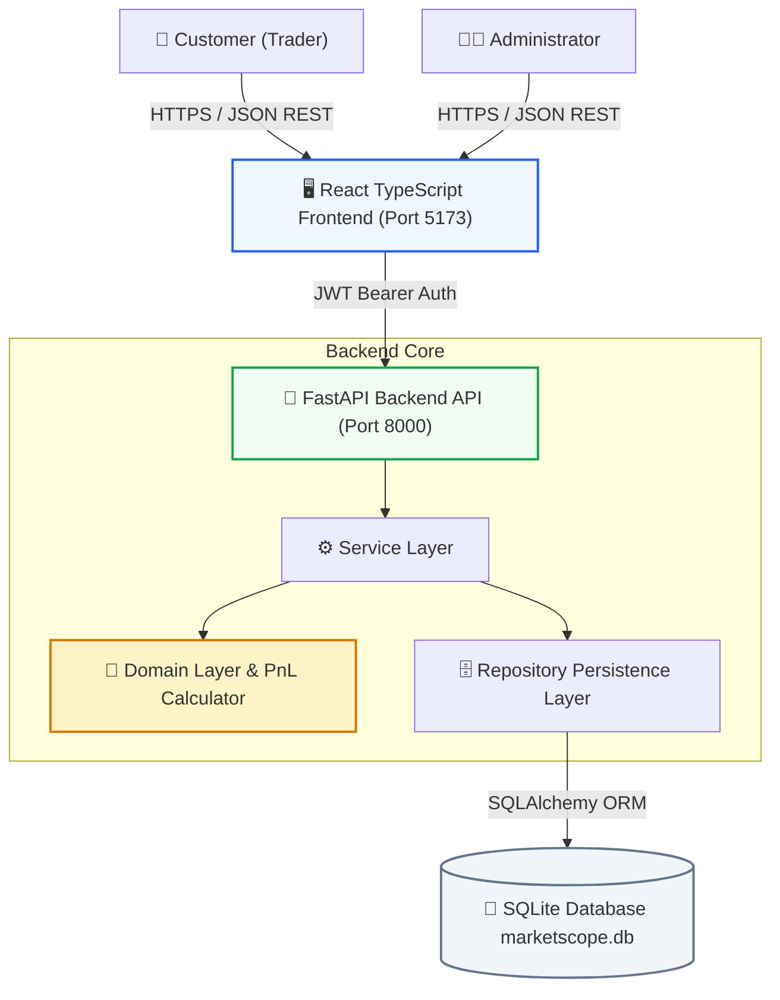
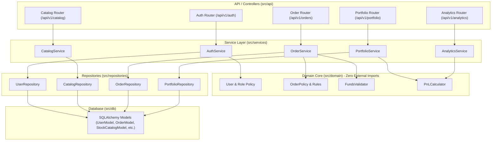
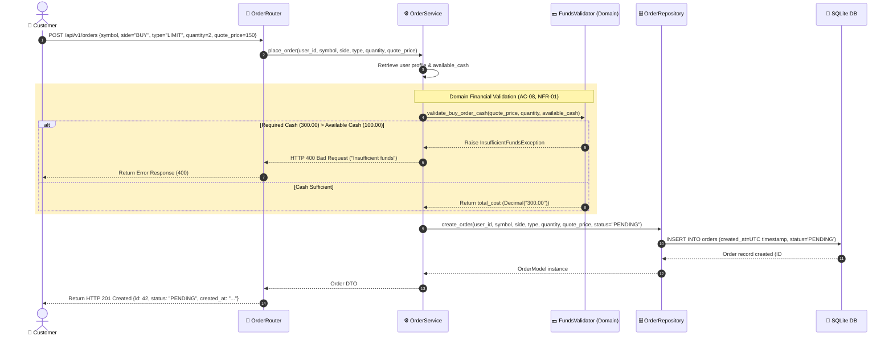

# MarketScope — System Architecture & Layered Design

**Business Case:** BC-AINE-006  
**System:** Stock Trading & Portfolio Analytics Platform  
**Stack:** FastAPI, SQLAlchemy, Pydantic, SQLite, React, TypeScript, Vite  

---

## 1. System Context Diagram

---

## 2. Layered Architecture Diagram

---

## 3. Order Placement Sequence Diagram (AC-06, AC-07, AC-08)

---

## 4. Architectural Discipline Summary
- **Layer Isolation:** Controllers access Services; Services access Domain & Repositories; Repositories access Database ORM models.
- **Domain Independence:** `src/domain/` contains pure Python models, calculators, and validators with zero dependencies on external frameworks or database layers.
- **Fixed-Point Financial Policy:** Python `Decimal` is enforced across all domain calculations and entity models (`NFR-01`).
