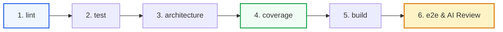

# MarketScope — CI/CD Pipeline & Quality Gates Specification

**Business Case ID:** BC-AINE-006  
**CI Configuration File:** `.gitlab-ci.yml` (and `.github/workflows/ci.yml`)  
**Pipeline Engine:** GitLab CI / GitHub Actions  

---

## 1. Pipeline Overview & Flow

---

## 2. Pipeline Stages & Detailed Job Execution

### Stage 1: `lint`
- **Job:** `lint_job`
- **Command:** `import-linter lint`
- **Purpose:** Verifies that no architectural layer contract is broken (Layered Architecture Contract & Domain Isolation Contract).
- **Quality Gate:** Pipeline aborts immediately if any layer violation is introduced.

### Stage 2: `test`
- **Job:** `unit_and_integration_tests_job`
- **Commands:** `pytest tests/unit/` && `pytest tests/integration/`
- **Purpose:** Executes all 47 unit and integration tests across Auth, Catalog, Watchlists, Orders, Portfolio, and Analytics.
- **Quality Gate:** 100% pass rate required.

### Stage 3: `architecture`
- **Job:** `architecture_tests_job`
- **Command:** `pytest tests/architecture/`
- **Purpose:** Executes 7 structural architecture tests:
  - Domain external layer isolation
  - Controller repository isolation
  - Repository controller isolation
  - Executed order immutability policy
  - Admin endpoint authorization checks
  - AST zero-float scanning across domain files

### Stage 4: `coverage`
- **Job:** `coverage_gate_job`
- **Commands:** `pytest --cov=src --cov-report=xml:coverage.xml`
- **Purpose:** Measures backend statement coverage and outputs `coverage.xml`.
- **Quality Gate:** Automated script verifies statement coverage $\ge 80\%$. Current system achieves **86%**.

### Stage 5: `build`
- **Job:** `frontend_build_job`
- **Commands:** `cd frontend && npm ci && npm run build`
- **Purpose:** Compiles React + TypeScript + Vite frontend into static production assets in `frontend/dist/`.
- **Quality Gate:** Zero TypeScript compilation errors (`tsc`) or Vite bundler failures.

### Stage 6: `e2e`
- **Job:** `e2e_playwright_and_ai_review_job`
- **Commands:** `npx playwright test` && `python scripts/run_quality_agent.py --ci-mode`
- **Purpose:** Runs browser end-to-end user journey tests and executes the Claude Code AI Substrate Evaluator.
- **Artifacts Generated:** `playwright-report/` & `docs/quality-agent-report.json`.

---

## 3. AI Review & Claude Code Quality Gate Integration
- The pipeline integrates `scripts/run_quality_agent.py` to evaluate the AI-Native Substrate before any PR merge:
  - Checks CLAUDE.md hierarchy presence across root, backend, frontend, domain, and tests.
  - Verifies AGENTS.md registry and custom agent definitions.
  - Verifies custom skills, commands, and pre-commit hooks.
  - Validates `docs/ac-traceability.md` completeness.

---

## 4. Pipeline Failure Behavior
1. **Immediate Job Termination:** Any command returning non-zero exit code halts the pipeline immediately.
2. **Merge Request Blocker:** Incomplete coverage (< 80%), broken import-linter contracts, or failing unit/integration tests hard-block PR merges.
3. **Artifact Retention:** Test logs, `coverage.xml`, and `playwright-report` are uploaded as CI artifacts for rapid root cause diagnosis.
