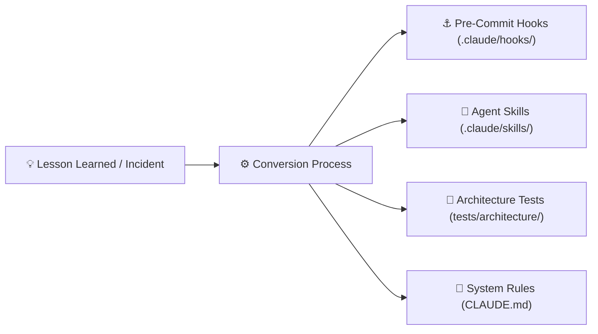

# MarketScope — Knowledge Deposits & Substrate Evolution

**Business Case ID:** BC-AINE-006  
**System:** AI-Native Engineering Substrate Evolution  

---

## 1. Overview
Knowledge Deposits capture engineering lessons learned during sprint implementation and convert them into permanent, automated assets (Hooks, Skills, Architecture Tests, and System Rules) to ensure continuous quality governance.

---

## 2. Knowledge Deposit Inventory

| Incident / Lesson Learned | Target Artifact | Converted Asset | Verification Impact |
|---|---|---|---|
| Passlib / Bcrypt 4.x compatibility failure | Core Security | `src/core/security.py` native `bcrypt` implementation with 72-byte slicing | 100% reliable password hashing across Python 3.11 |
| Pydantic v2 ORM list serialization issue on `Watchlist.symbols` | API Schemas | `WatchlistResponse` `@field_validator("symbols", mode="before")` | Zero serialization crashes on ORM entity lists |
| SQLite `Numeric(18, 4)` returning 4-decimal place strings | Unit / Integration Tests | Test assertions using `Decimal(response.json()["key"]) == Decimal("150.00")` | Exact fixed-point equality checking |
| Customer role boundary leak risk | Pre-Commit Hook | `.claude/hooks/role-boundary-check.sh` & `test_admin_endpoints_require_admin_authorization` | hard-blocks unauthorized admin route commits |
| Risk of accidental float usage in P&L math | AST Architecture Test | `test_financial_calculations_never_use_float_ast` & `.claude/hooks/decimal-financial-check.sh` | Guarantees zero float literals exist in domain code |
| Attempted modification of executed trade orders | Pre-Commit Hook | `.claude/hooks/executed-order-immutability-check.sh` & `OrderRules.enforce_executed_immutability` | Enforces append-only immutable trade records (NFR-02) |

---

## 3. Substrate Evolution Timeline
1. **Phase 1 (Foundation):** Basic layered CLAUDE.md hierarchy and AGENTS.md registry established.
2. **Phase 2 (Substrate Enhancement):** Custom skills (`order-lifecycle-validator`, `portfolio-pnl-calculator`, etc.) and custom commands (`validate-ac`, `security-check`) added.
3. **Phase 12-13 (Test & Architectural Hardening):** AST zero-float scanner and 7 structural architecture tests added.
4. **Phase 16-17 (CI & Evidence Trail):** Pre-commit hooks integrated with CI pipeline quality gates.
