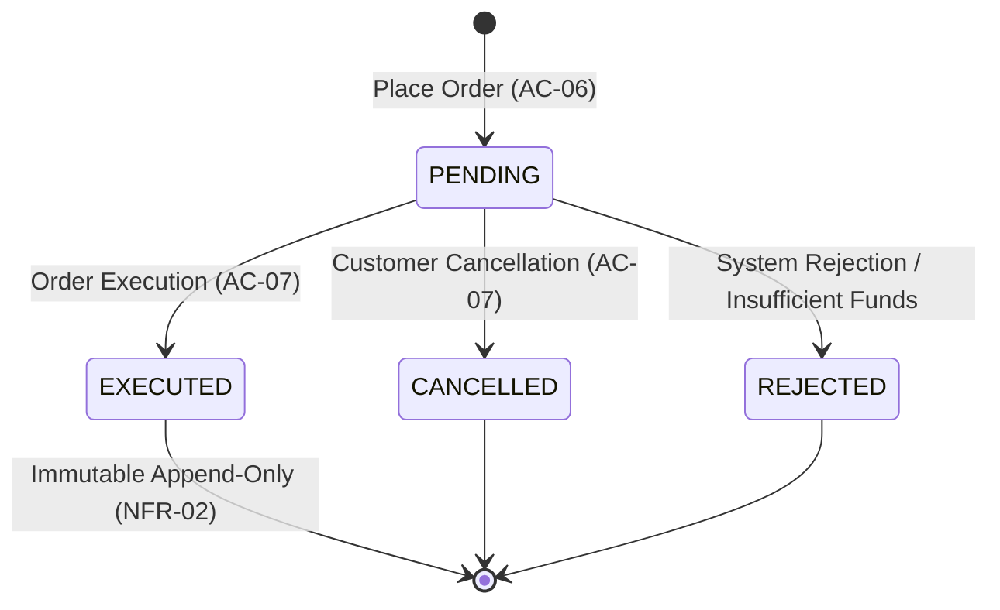

# Order Placement & Lifecycle Architecture

**System Component:** Trade Order Management & Execution Engine  
**Business Case:** BC-AINE-006 (MarketScope)  
**Acceptance Criteria:** AC-06, AC-07, AC-08  
**Non-Functional Requirements:** NFR-01 (Decimal Arithmetic), NFR-02 (Immutable Appended Trade Records)

---

## 1. Overview
The Trade Order Management system provides multi-asset trade order placement (`BUY`/`SELL`, `MARKET`/`LIMIT`), strict state machine transitions, funds verification using Python `Decimal`, and post-execution immutability guarantees.

---

## 2. Order Types & Execution Modes
| Order Type | Side | Description | Initial Status |
|---|---|---|---|
| `MARKET` | `BUY` | Purchase stock at market quote price. Cash verified before placement. | `PENDING` |
| `MARKET` | `SELL` | Sell stock holdings at market quote price. Cash credited upon execution. | `PENDING` |
| `LIMIT` | `BUY` | Purchase stock at specified limit price or better. | `PENDING` |
| `LIMIT` | `SELL` | Sell stock holdings at specified limit price or better. | `PENDING` |

---

## 3. Order Lifecycle State Machine

### Transition Matrix & Rules
- **Allowed Transitions:**
  - `PENDING` → `EXECUTED`
  - `PENDING` → `CANCELLED`
  - `PENDING` → `REJECTED`
- **Forbidden Transitions:** All other transitions (e.g. `EXECUTED` → `PENDING`, `EXECUTED` → `CANCELLED`, `CANCELLED` → `EXECUTED`) are ILLEGAL and raise `InvalidOrderStateException` / `HTTP 400 Bad Request`.

---

## 4. Financial Calculation Policy (NFR-01 & AC-08)
- All financial calculations (`quote_price`, `quantity`, `available_cash`, `total_cost`) use Python `Decimal` exclusively.
- **Zero Floating-Point Policy:** Float types (`float`) are prohibited across domain models, services, repositories, and API controllers.
- **Funds Verification Rule (AC-08):**
  $$\text{Required Cash} = \text{quote\_price} \times \text{quantity}$$
  $$\text{If } \text{Required Cash} > \text{available\_cash} \implies \text{Raise } \texttt{InsufficientFundsException}$$

---

## 5. Immutability & Auditability Guarantees (NFR-02)
- Executed trade records are stored in the database (`orders` table) with status `EXECUTED`.
- Executed orders are **append-only**:
  - No `UPDATE` allowed on executed trade parameters.
  - No `DELETE` allowed on executed trade records.
- Server-side timestamping (`created_at`, `updated_at`) using UTC (`datetime.now(timezone.utc)`) ensures auditability across all order transitions.

---

## 6. Acceptance Criteria Mapping

| AC ID | Description | Component Location | Verification Test |
|---|---|---|---|
| **AC-06** | Place Order with server-side timestamp & `PENDING` status | `src/api/order_router.py` `src/services/order_service.py` | `tests/integration/test_order_api.py::test_ac_06_order_placement_api` |
| **AC-07** | Lifecycle State Machine Enforcement & Immutability | `src/domain/order_policy.py` `src/domain/order_rules.py` | `tests/integration/test_order_api.py::test_ac_07_order_lifecycle_execution_and_immutability_api` `tests/unit/test_order_policy.py` |
| **AC-08** | BUY Insufficient Funds Validation | `src/domain/funds_validator.py` `src/services/order_service.py` | `tests/integration/test_order_api.py::test_ac_08_insufficient_funds_validation_api` |
