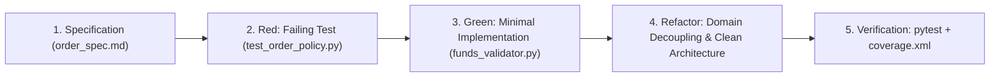

# Test-Driven Development (TDD) Practice & Worked Example

**System:** MarketScope Stock Trading Platform (BC-AINE-006)  
**Methodology:** Specification-First Test-Driven Development  
**Worked Example:** `AC-08` Insufficient Funds Validation  

---

## 1. Specification-First TDD Philosophy

In MarketScope, software engineering proceeds strictly from formal specifications (`specs/`) to automated tests (`tests/`), followed by domain and service implementations (`src/`).



---

## 2. The TDD Cycle Explained

### Phase 1: Red (Failing Test First)
Before writing any business logic in `src/domain/funds_validator.py` or `src/services/order_service.py`, an explicit failing test was authored referencing requirement `AC-08`:

```python
# tests/unit/test_order_policy.py
@pytest.mark.unit
@pytest.mark.ac("AC-08")
def test_buy_order_insufficient_funds_exception():
    """Verify AC-08: BUY order raises InsufficientFundsException when cost > available cash."""
    quote_price = Decimal("150.00")
    quantity = Decimal("10")
    available_cash = Decimal("1000.00")  # Required = 1500.00 > Available 1000.00

    with pytest.raises(InsufficientFundsException):
        OrderPolicy.validate_buy_order_funds(quote_price, quantity, available_cash)
```

**Initial Execution Result (Red State):**
`NameError: name 'InsufficientFundsException' is not defined` / `AttributeError: type object 'OrderPolicy' has no attribute 'validate_buy_order_funds'`.

---

### Phase 2: Green (Make the Test Pass)
To satisfy `AC-08` and pass the test, minimal implementation code was added using Python `Decimal` arithmetic:

```python
# src/domain/exceptions.py
class InsufficientFundsException(DomainException):
    """Raised when BUY order total cost exceeds customer available cash (AC-08)."""
    pass

# src/domain/funds_validator.py
class FundsValidator:
    @classmethod
    def validate_buy_order_cash(
        cls, quote_price: Decimal, quantity: Decimal, available_cash: Decimal
    ) -> Decimal:
        if quote_price <= Decimal("0") or quantity <= Decimal("0"):
            raise ValueError("Quote price and quantity must be strictly positive.")

        total_cost = quote_price * quantity
        if total_cost > available_cash:
            raise InsufficientFundsException(
                f"Insufficient funds: Required {total_cost} exceeds available {available_cash}."
            )
        return total_cost
```

**Second Execution Result (Green State):**
`tests/unit/test_order_policy.py::test_buy_order_insufficient_funds_exception PASSED`.

---

### Phase 3: Refactor (Decouple & Clean Architecture)
With tests passing cleanly, the logic was refactored:
1. **Domain Isolation:** Moved funds checking out of API handlers directly into `FundsValidator` in `src/domain/` so it has zero external dependencies.
2. **Type Enforcement:** Added runtime checks ensuring `quote_price`, `quantity`, and `available_cash` are `Decimal` instances (rejecting `float`).
3. **Integration Binding:** Integrated `FundsValidator` into `OrderService.place_order` and `OrderRepository.execute_order` to prevent double-spending during order execution.

---

## 3. Specification to Implementation Mapping

| Spec Requirement | Test Location & Marker | Domain / Service Implementation |
|---|---|---|
| `AC-06`: Order Placement & Timestamp | `test_ac_06_order_placement_api` | `OrderService.place_order`<br>`OrderRepository.create_order` |
| `AC-07`: Lifecycle Enforcement & Immutability | `test_ac_07_order_lifecycle_execution_and_immutability_api` | `OrderPolicy.validate_state_transition`<br>`OrderRules.enforce_executed_immutability` |
| `AC-08`: Insufficient Funds Validation | `test_ac_08_insufficient_funds_validation_api`<br>`test_buy_order_insufficient_funds_exception` | `FundsValidator.validate_buy_order_cash` |
| `AC-09`: Portfolio Stats & Decimal P&L | `test_ac_09_portfolio_stats_api` | `PnLCalculator.calculate_portfolio_stats` |
| `AC-10`: Daily Top Gainers & Losers | `test_ac_10_daily_top_gainers_and_losers_api` | `PnLCalculator.calculate_top_gainers_and_losers` |
