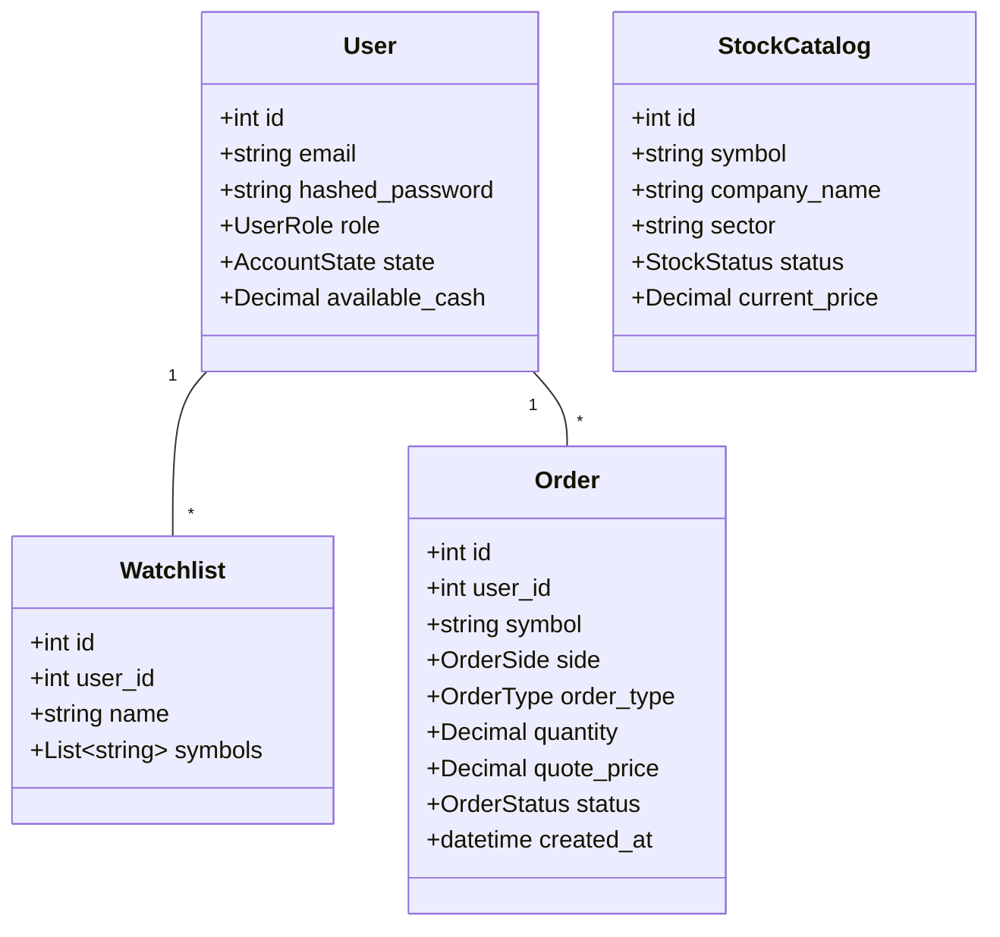

# MarketScope — Root Application Specification
**Business Case ID:** BC-AINE-006  
**Domain:** FinTech — Capital Markets / Brokerage  
**Project Type:** AI-Native Engineering Capstone  

---

## 1. Purpose
The purpose of the MarketScope platform is to provide a self-serve retail brokerage and portfolio analytics system. It allows customers to onboard, browse stock catalogs, manage custom watchlists, place and cancel trade orders, track portfolio performance, and view daily analytics.

---

## 2. Scope
### In-Scope Functional Modules
- User Onboarding & Account Management (AC-01, AC-02)
- Stock Catalog Administration & Discovery (AC-03)
- Watchlist Management (AC-04, AC-05)
- Order Placement & Lifecycle Execution (AC-06, AC-07, AC-08)
- Portfolio Tracking & Analytics Dashboard (AC-09, AC-10)

### Out-of-Scope
- Real exchange order-matching engine (execution is stubbed via state transitions).
- Real brokerage clearing or T+1 settlement infrastructure.
- Margin, options, futures, leverage, or FX multi-currency trading.
- WebSocket streaming (polled REST endpoints are used).

---

## 3. Actors
1. **Unauthenticated User (Guest):** Can register an account.
2. **Customer:** Authenticated retail trader. Can manage profile, browse catalog, manage watchlists (max 10), place/cancel orders, view holdings, and inspect P&L analytics.
3. **Admin:** System administrator. Can manage user roles, audit role updates, and perform stock catalog CRUD operations.
4. **System / Evaluator:** Automated agent supervisor and evaluator executing quality gates.

---

## 4. User Journeys
1. **Onboarding Journey:** Guest registers → Account created in `ACTIVE` state with `role = CUSTOMER` → Logs in → Obtains JWT access token.
2. **Catalog & Watchlist Journey:** Customer searches stock catalog → Creates named watchlist with symbols → Modifies watchlist atomically.
3. **Trading Journey:** Customer checks available cash balance → Places Market/Limit BUY/SELL order → Order enters `PENDING` → Executes or Cancels.
4. **Portfolio Analytics Journey:** Customer navigates to Dashboard → Views `total_invested`, `current_value`, `absolute_pnl`, `percent_pnl` → Inspects Top 5 Gainers and Top 5 Losers.

---

## 5. Business Rules & Governance Invariants
- **Fixed-Point Financial Rule (NFR-01):** Prices, quantities, cash, and P&L metrics MUST use Python `Decimal`. Floating-point numbers are prohibited.
- **Executed Order Immutability (NFR-02):** Orders in `EXECUTED` status cannot be updated or deleted.
- **Soft-Delete Catalog Rule (AC-03):** Stock deletions move symbols to `DELETED` state. Hard-deletes are forbidden.
- **Role Partitioning (NFR-04):** Administrative endpoints require `ADMIN` role. Customer endpoints require `CUSTOMER` role.
- **Spec-Is-Truth Rule:** When code and spec conflict, the spec wins.

---

## 6. Global Domain Model Overview

---

## 7. API Routing Architecture
- `POST /api/v1/auth/register` — Customer Registration
- `POST /api/v1/auth/login` — Authentication & JWT Token
- `PUT /api/v1/admin/users/{user_id}/role` — Admin Role Management
- `POST/GET/PUT/DELETE /api/v1/admin/catalog` — Stock Catalog CRUD
- `POST/GET/PUT/DELETE /api/v1/watchlists` — Watchlist Administration
- `POST/GET/DELETE /api/v1/orders` — Order Placement & Cancellation
- `GET /api/v1/portfolio/stats` — Customer Portfolio Statistics
- `GET /api/v1/analytics/daily` — Daily Top Gainers & Losers

---

## 8. Error Handling Strategy
- Domain violations raise specific subclasses of `DomainException` (`WatchlistUpdateException`, `InvalidOrderStateException`, `InsufficientFundsException`).
- Global FastAPI exception handler maps domain exceptions to standard RFC 7807 JSON error responses with correlation IDs (`X-Correlation-ID`).

---

## 9. Security Requirements
- Passwords hashed via bcrypt (`passlib`). Plaintext credentials never logged (NFR-03).
- Authorization enforced at controller layer via FastAPI HTTPBearer dependencies (NFR-04).
- Request correlation IDs attached to all logs (NFR-06).

---

## 10. Acceptance Criteria Reference Index
- **AC-01:** Customer Registration (`specs/user-management_spec.md`)
- **AC-02:** Admin Role Management (`specs/user-management_spec.md`)
- **AC-03:** Stock Catalog Management (`specs/stock-catalog_spec.md`)
- **AC-04:** Watchlist Count Limits (`specs/watchlist_spec.md`)
- **AC-05:** Atomic Watchlist Updates (`specs/watchlist_spec.md`)
- **AC-06:** Order Placement (`specs/order_spec.md`)
- **AC-07:** Order State Machine (`specs/order_spec.md`)
- **AC-08:** Insufficient Funds Validation (`specs/order_spec.md`)
- **AC-09:** Portfolio Performance Metrics (`specs/portfolio_spec.md`)
- **AC-10:** Daily Gainers & Losers Ranking (`specs/analytics_spec.md`)

---

## 11. Negative Test Cases Summary
- Duplicate email registration attempt → HTTP 400.
- Customer attempting Admin role update → HTTP 403.
- Creating 11th watchlist → `WatchlistUpdateException`.
- BUY order exceeding cash balance → `InsufficientFundsException`.
- Modifying EXECUTED order status → `InvalidOrderStateException`.

---

## 12. Non-Functional Requirements
- **NFR-01:** Fixed-Point Decimal Math (`Decimal` / `Numeric(18, 4)`).
- **NFR-02:** Append-Only Executed Orders.
- **NFR-03:** Bcrypt Password Hashing & Credentials Protection.
- **NFR-04:** Controller Layer Role Partitioning.
- **NFR-05:** Append-Only Migrations.
- **NFR-06:** Structured JSON Logs with Correlation IDs.
- **NFR-07:** Health Endpoint Response < 1s.
- **NFR-08:** Structural Architecture Test Verification.

---

## 13. Specification Hierarchy Dependencies
- Root Spec -> Feature Specs (`user-management`, `stock-catalog`, `watchlist`, `order`, `portfolio`, `analytics`).
